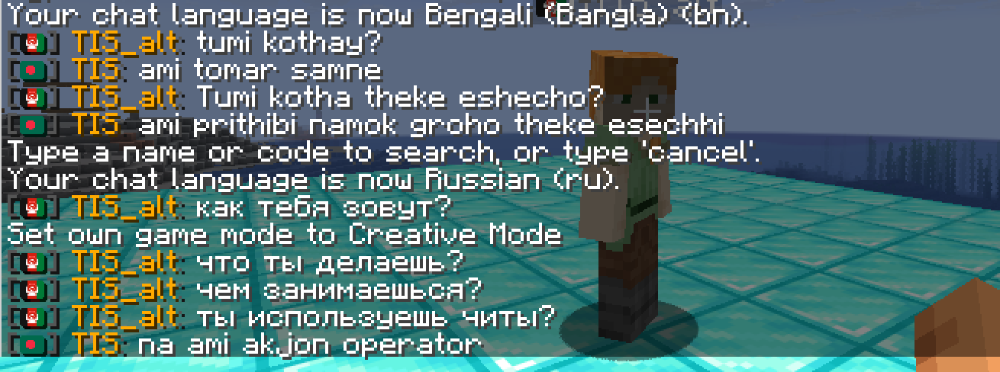
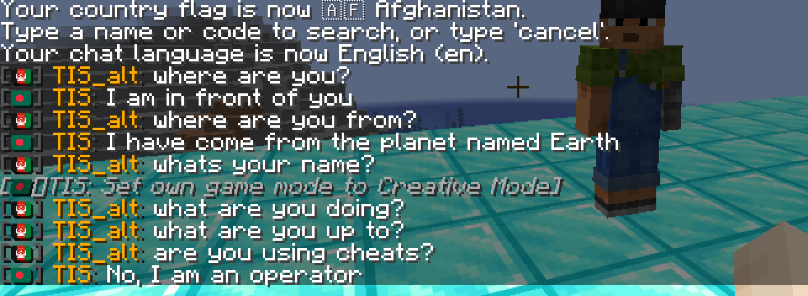
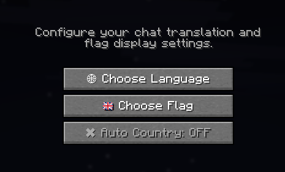
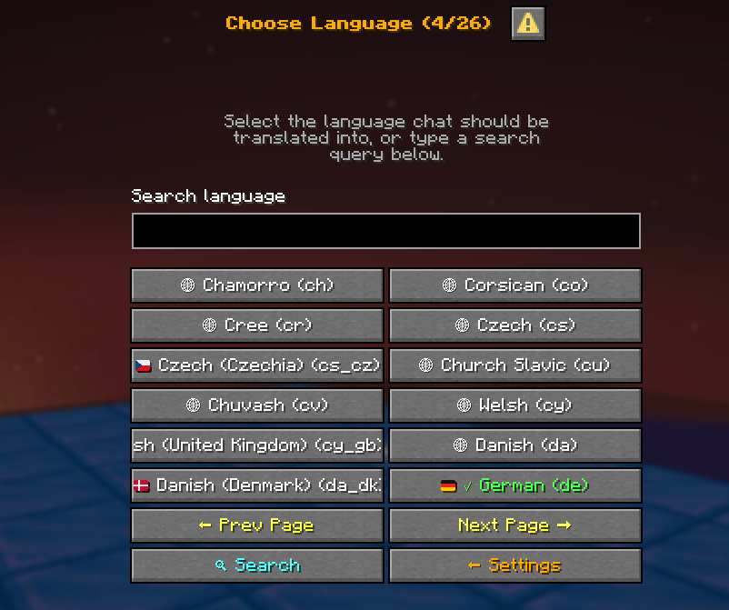
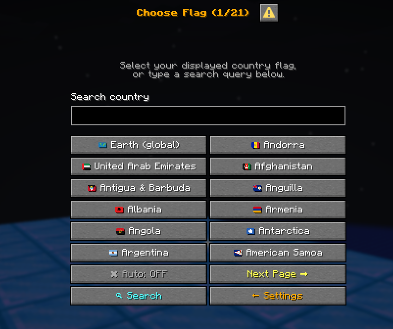
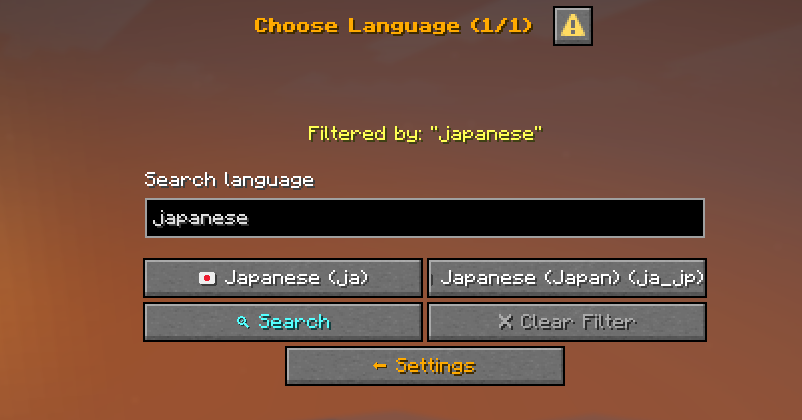
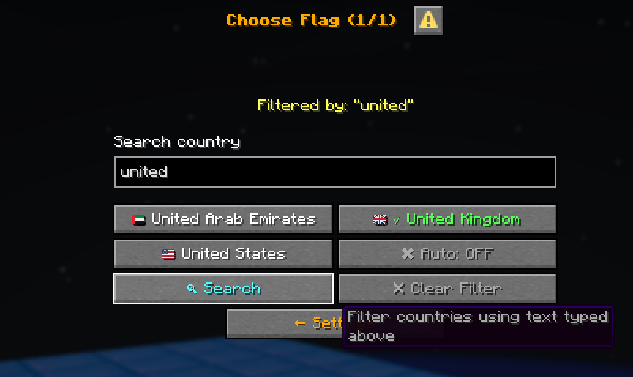
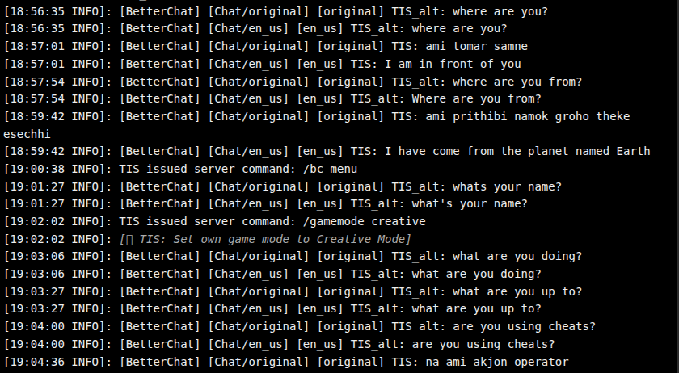

# BetterChat

<p align="center">
  
</p>

<h3 align="center">One chat. Every language. A little more of home.</h3>

<p align="center">
  
  
  
  
  
  
</p>

**BetterChat** translates player chat into each listener's chosen language and shows a country flag beside player names. Players who speak different languages can share one chat, and everyone reads it in their own. It runs its own chat format when no formatter is active, or exposes placeholders and a VentureChat listener adapter when another chat plugin owns formatting.

> **Pre-release 0.1.0-pre.1.** Please test on a staging server and keep backups of your configs. Feedback shapes the first stable release.

## Screenshots

<p align="center">
  
</p>
<p align="center"><em>Switch language at any time and the same conversation follows you.</em></p>

<p align="center">
  
</p>
<p align="center"><em>Each player reads the chat in their own language, with the sender's flag beside the name.</em></p>

### Menus

`/bc menu` opens a settings screen with searchable, paged pickers.

<table>
  <tr>
    <td align="center"><br><sub>Settings</sub></td>
    <td align="center"><br><sub>Language picker</sub></td>
    <td align="center"><br><sub>Flag picker</sub></td>
  </tr>
  <tr>
    <td align="center"><br><sub>Search languages</sub></td>
    <td align="center"><br><sub>Search flags</sub></td>
    <td align="center"><br><sub>Console: original and translated</sub></td>
  </tr>
</table>

## Features

- **Recipient-aware translation:** only the languages your real listeners need are requested, not every language on the server.
- **Many AI providers:** Gemini, OpenAI-compatible APIs, Anthropic, xAI, Groq, OpenRouter and local Ollama.
- **Resilient:** multiple keys and models per provider, automatic fallback, request batching and caching. A key that returns HTTP 429 is skipped until restart.
- **Any language:** Minecraft locales, Java's ISO-639 list, and custom names or codes. Languages outside Minecraft's locale list are returned in Latin-letter romanization (Bengali becomes `Ekhane Asho`).
- **Easy menus:** `/bc menu` opens a settings screen with searchable, paged language and flag pickers and an automatic-country toggle.
- **`/translate <language> <text>`:** one-off translations through the same queue and cache.
- **Country flags:** 249 country flags plus a global **Earth** flag in chat, the tab list and optional overhead nametags.
- **Flag resource pack:** a generated pack with crisp flag glyphs from Twemoji artwork. Unicode emoji are the fallback.
- **Player control:** set language and flag, or opt out of translation with `/translation off` to always see the original.
- **Optional IP-based country detection:** plus language and country blacklists.
- **Integrations:** PlaceholderAPI, LuckPerms and Vault groups, VentureChat (local channels), and formatters that use Paper's `ChatRenderer`.
- **Networks:** Velocity and BungeeCord jars with shared MariaDB storage and HMAC-signed chat relay. SQLite for a single server.
- **Modern:** MiniMessage formats, Adventure components and Folia support.

Three jars are built: Paper/Folia, BungeeCord and Velocity. bStats is included with plugin IDs 34609, 34611 and 34610 respectively.

## Requirements

- Java 25
- Paper 26.2 / 26.3 or compatible Folia
- MariaDB for proxy mode (SQLite for a standalone server)
- A translation provider key or a reachable Ollama endpoint (optional until you enable translation)

PlaceholderAPI, LuckPerms, Vault and VentureChat are optional integrations.

## Install

### One Paper or Folia server

1. Download `BetterChat-Paper-0.1.0-pre.1.jar` from the [releases](../../releases) or build it with Gradle.
2. Put it in `plugins/` and start the server once.
3. Edit `plugins/BetterChat/config.yml` for storage and flags. Keep `proxy-mode.enabled: false` and `storage.type: sqlite` for a standalone server.
4. Edit `plugins/BetterChat/ai.yml` for chat behavior and AI provider keys. Enable `chat.translation-enabled` if you want chat translated, then restart.
5. Use `/bc menu` to choose a language and flag.

### BungeeCord or Velocity network

Install the matching proxy jar on the proxy and the Paper jar on **every backend**. Set `proxy-mode.enabled: true` in each BetterChat config, set `storage.type: mariadb` with the same database credentials everywhere, generate a secret with `openssl rand -hex 32` and copy it to `proxy-mode.secret` in every config, and give each Paper backend a unique `proxy-mode.server-id`. Proxy mode refuses to start if the shared MariaDB connection can't be initialized. See [Proxy installation](docs/PROXY.md).

## Flag resource pack

Flags look best with the included resource pack: **249 country flags and a rectangular Earth flag**, drawn as crisp glyphs in the `betterchat:flags` font from Twemoji artwork. The pack is optional. Without it, BetterChat falls back to Unicode flag emoji, and the flag buttons in the menus show emoji instead of glyphs.

The pack is generated at [`resource-pack/BetterChat-Flags.zip`](resource-pack/BetterChat-Flags.zip) and shipped as `BetterChat-Flags-0.1.0-pre.1.zip` in the release assets.

- Download `BetterChat-Flags-0.1.0-pre.1.zip` from the release assets. Its SHA-1 is in `RESOURCE-PACK-SHA1.txt` in the same bundle.
- Upload the ZIP to a **public HTTPS URL** that returns the file directly. A file path on your server is not enough.
- One pack covers Minecraft Java 26.2 and 26.3 (resource pack formats 88.0 to 97.1).

**Option A: send it with Paper (simplest)**

```properties
resource-pack=https://example.com/BetterChat-Flags.zip
resource-pack-sha1=YOUR_40_CHARACTER_SHA1
resource-pack-prompt=Install BetterChat Flags to see country flags.
require-resource-pack=false
```

Then set `flags.resource-pack.use-glyphs: true` in `plugins/BetterChat/config.yml` and leave `flags.resource-pack.enabled: false` so the pack isn't sent twice.

**Option B: let BetterChat send it**

```yaml
flags:
  resource-pack:
    enabled: true
    url: 'https://example.com/BetterChat-Flags.zip'
    sha1: 'YOUR_40_CHARACTER_SHA1'
    prompt: 'Install BetterChat Flags to see country flags.'
    required: false
    use-glyphs: true
```

**Good to know**

- If both options use the same URL, BetterChat detects it and avoids a duplicate prompt.
- On a proxy network, repeat your chosen setup on every backend so players get the same font everywhere.
- Keep `required: false` unless you want to block players who don't accept the pack.
- Flags show as letters or empty boxes? The pack isn't installed yet, or `use-glyphs` is off. The emoji fallback works until the pack is hosted and accepted.
- Other chat plugins: `%betterchat_flag_glyph%` only renders correctly if that plugin applies the `betterchat:flags` font. Otherwise use `%betterchat_flag%` (emoji).

Generation, hosting and Twemoji attribution are covered in the [Flag pack guide](docs/RESOURCE-PACK.md).

## Commands

| Command | Description |
| --- | --- |
| `/bc` or `/bc menu` | Open the settings menu (language, flag, auto country) |
| `/bc language <language>` | Set your language by code or name (`en_us`, `bn`, `Toki Pona`) |
| `/bc flag <country\|earth>` | Set your flag by code or name, or `earth` / `global` |
| `/translation <on\|off>` | Receive translated chat, or always the original |
| `/translate <language> <text>` | Translate one message |
| `/bc auto [on\|off]` | Toggle IP-based country detection |
| `/bc set <player> <language\|flag> <value>` | Admin: change a player's preference |
| `/bc reload` | Admin: reload configuration |

`betterchat.use` and `betterchat.translate` are granted to everyone by default. `betterchat.admin` (op) covers `/bc set` and `/bc reload`. `/translate` works whenever a provider is configured, even when automatic chat translation is off. The `/translation` preference is saved per player, and opted-out players don't contribute their language to a chat request unless another opted-in recipient needs it.

## Placeholders

With PlaceholderAPI installed, BetterChat registers the `betterchat` expansion:

| Placeholder | Value |
| --- | --- |
| `%betterchat_flag%` | Unicode flag emoji for the selected country |
| `%betterchat_flag_glyph%` | Resource-pack private-use glyph |
| `%betterchat_nation%`, `%betterchat_nationality%`, `%betterchat_country%` | Country name |
| `%betterchat_country_code%`, `%betterchat_nation_code%` | Country code, including `EARTH` |
| `%betterchat_global_flag%`, `%betterchat_earth_flag%` | Earth emoji |
| `%betterchat_global_flag_glyph%`, `%betterchat_earth_flag_glyph%` | Earth resource-pack glyph |
| `%betterchat_language%`, `%betterchat_language_code%` | Selected language code or custom language name |
| `%betterchat_language_name%` | English display name, including custom languages |
| `%betterchat_automatic_country%` | Whether IP detection is enabled for that player |

For BetterChat's own MiniMessage format strings, use `<player>`, `<flag>`, `<global_flag>`, `<earth_flag>`, `<language>`, `<country>` and `<message>`. See [Formatting and integrations](docs/INTEGRATIONS.md).

## Chat formatting and channels

With no recognized formatter active, BetterChat renders chat with `chat.format` or its built-in format, and `chat.flag-position` selects before-name or after-name placement. When a configured formatter is detected, BetterChat leaves its format alone and keeps placeholders available. On standalone Paper/Folia it can translate through modern Paper `ChatRenderer`s while preserving their per-viewer format. The optional VentureChat adapter translates VentureChat's actual **local** channel recipients. It is reflection-based: BetterChat does not bundle VentureChat classes or copy its GPL-3.0 code. VentureChat's own proxy relay still owns cross-server delivery, and remote channel recipients are not currently translated.

## Translation providers

Translation is off by default. Enable `chat.translation-enabled` and add keys under `translation.providers` in `plugins/BetterChat/ai.yml`.

| Provider id | API style |
| --- | --- |
| `gemini` | Native Gemini text generation |
| `openai` | OpenAI Chat Completions |
| `openrouter` | OpenRouter Chat Completions |
| `groq` | Groq Chat Completions |
| `anthropic` | Anthropic Messages API |
| `xai` | xAI Chat Completions |
| `ollama` | Local OpenAI-compatible chat endpoint |

Providers receive the sender's selected language as a **probable** source-language hint and only the target languages needed by the active recipient batch. Busy bursts are coalesced into batches (32 messages by default). If an HTTP 429 is returned, that key is disabled for the rest of the process and other keys and providers are tried. Untranslated recipients can fall back to the original message, controlled by `chat.show-original-on-translation-failure`. See [Translation setup and provider examples](docs/TRANSLATION.md). Provider access, billing and terms are managed by the server owner.

## Privacy

When translation is on, chat text is sent to the provider you configure, so review that provider's data terms. The optional IP lookup sends the player's IP to the configured endpoint (default `ipapi.co`) and does not store it. bStats is anonymous and can be disabled in the config. Server owners are responsible for disclosing these data flows to players. See [Privacy and data handling](docs/PRIVACY.md).

## Build

```shell
./gradlew assemble
```

Outputs:

```text
paper/build/libs/BetterChat-Paper-0.1.0-pre.1.jar
bungeecord/build/libs/BetterChat-BungeeCord-0.1.0-pre.1.jar
velocity/build/libs/BetterChat-Velocity-0.1.0-pre.1.jar
resource-pack/BetterChat-Flags.zip
```

`python3` and Java 25 are required for the pack generator. The pack graphics are checked in, so regular builds don't need network access. To collect the pre-release assets and checksums in one directory, run `./gradlew preparePreRelease`. The bundle is written to `build/pre-release/0.1.0-pre.1/`.

## Documentation

- [Paper/Folia and proxy installation](docs/PROXY.md)
- [Configuration reference](docs/CONFIGURATION.md)
- [Translation providers and batching](docs/TRANSLATION.md)
- [Chat formats, commands, placeholders and integrations](docs/INTEGRATIONS.md)
- [Resource pack generation and hosting](docs/RESOURCE-PACK.md)
- [Privacy and data handling](docs/PRIVACY.md)

## Feedback

Please try the standalone Paper/Folia setup and both proxy modes, especially mixed-language chat, reconnects, resource-pack delivery and existing formatter integrations. When you open an [issue](../../issues), include your platform and version details.

## Credits

Flag and globe images are from [Twemoji](https://github.com/twitter/twemoji) and are licensed under CC BY 4.0. The complete license and attribution are included in the pack and [`resource-pack/THIRD_PARTY_NOTICES.md`](resource-pack/THIRD_PARTY_NOTICES.md). BetterChat is not affiliated with Twemoji or VentureChat.

## References

- [Paper documentation](https://docs.papermc.io/paper/)
- [Velocity documentation](https://docs.papermc.io/velocity/)
- [Adventure documentation](https://docs.papermc.io/adventure/)
- [Folia support](https://docs.papermc.io/paper/dev/folia-support/)
- [VentureChat repository](https://github.com/Aust1n46/VentureChat)